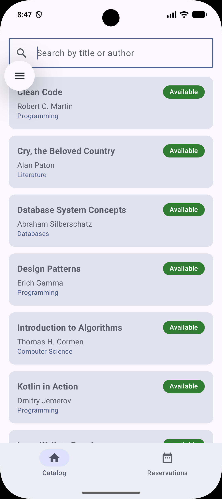
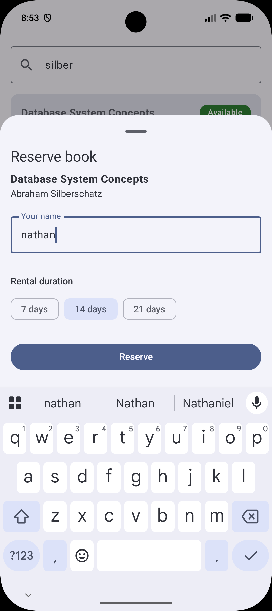
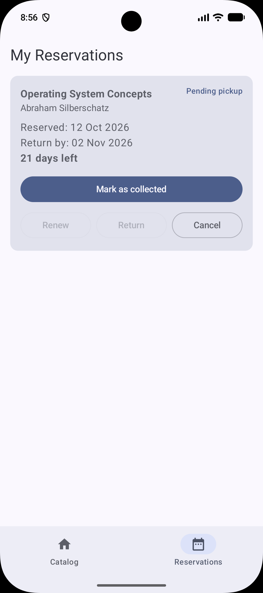
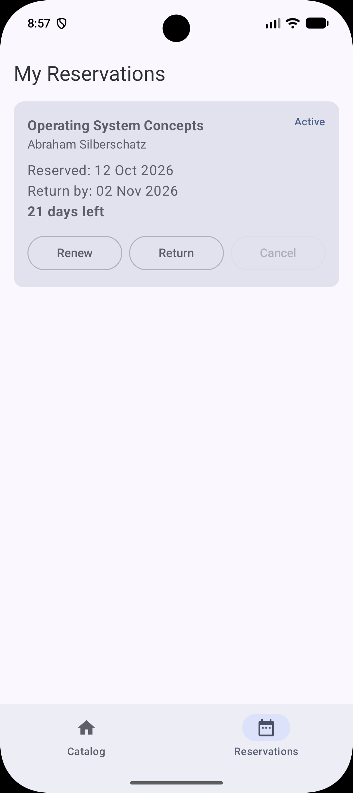

# Kitabu - Library Book Rental & Reservation System

This is a native Android app built for students  and they can browse a library catalogue, reserve books, and manage their rentals
(collect, renew, return, cancel) with all data stored locally on the device.

**Student:** Nathan van huyssteen | **Module:** MADB372 | **Assignment:** SF1

## Features

- Browse the book catalogue with availability badges (green = Available, orange = Borrowed)
- Search books by title or author
- Reserve an available book and choose a rental duration (7, 14 or 21 days)
- Reservations dashboard showing reservation date, return deadline and days remaining
- Mark a reservation as collected, renew it, return it, or cancel it
- Catalogue updates instantly when a book is reserved or returned
- Works fully offline (local Room database, pre-populated with 10 sample books)

## Tech Stack

| Area | Technology |
|---|---|
| Language | Kotlin |
| UI | Jetpack Compose (Material 3) |
| Navigation | Navigation Compose (single activity) |
| Database | Room (SQLite) with KSP |
| Async / reactive | Kotlin Coroutines and Flow / StateFlow |
| Architecture | MVVM |
| Minimum SDK | API 26 |

## Architecture

The app follows MVVM with four layers. Data flows up from the database as Flows,
and user actions flow down as function calls.

```
Compose screens (ui/)  ->  ViewModel  ->  Repository  ->  Room DAO / Database (data/)
```

- **UI layer:** Compose screens only draw state and report taps. They hold no business logic.
- **ViewModel:** `LibraryViewModel` exposes the books and bookings as `StateFlow`
  and runs every database action inside `viewModelScope.launch`.
- **Repository:** `LibraryRepository` validates input and groups multi-step actions
  (reserve, return, cancel) into database transactions.
- **Data layer:** Room entities, the DAO, type converters and the database singleton.

## Project Structure

```
com.nathan.kitabu
├── data
│   ├── LibraryRepository.kt
│   └── local          (BookEntity, BookingEntity, LibraryDao, LibraryDatabase, Converters ...)
├── di                 (AppContainer)
├── domain             (DateUtils)
└── ui
    ├── components     (BookCard, BookingCard, ReserveSheet)
    ├── navigation     (Screen, KitabuApp)
    ├── screens        (CatalogScreen, BookingsScreen)
    ├── theme
    └── viewmodel      (LibraryViewModel)
```

## CRUD Operations

| Operation | Where it happens | DAO function |
|---|---|---|
| Create | Reserve a book (new booking) | `insertBooking` |
| Read | Catalogue, search, dashboard | `getAllBooks`, `searchBooks`, `getActiveBookings` |
| Update | Renew a booking | `updateReturnDeadline` |
| Update | Collect / return a booking | `updateBookingStatus`, `setBookAvailability` |
| Delete | Cancel a pending booking | `deleteBooking` |

## Setup

1. Install Android Studio and JDK 17 or newer.
2. Clone the repository:
```
   git clone https://github.com/Nathan-4918/Kitabu_MADB372_SF1.git
```
3. Open the `Kitabu` folder in Android Studio and wait for Gradle to sync.
4. Create an emulator (API 26 or higher) or plug in an Android device.
5. Press **Run**. The database is created on first launch and filled with 10 sample books.

To reset the sample data, uninstall the app or clear its storage and run it again.

## Screenshots

### Catalogue


### Reserve a book


### Reservations dashboard


### Renew / return / cancel

